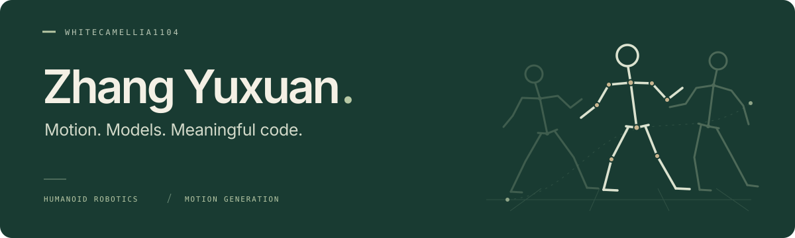

  

  <b>探索动作生成，连接模型与真实执行。</b> 
  Exploring motion, generative models, and the path to physical execution.

  <a href="https://yuxuan-personal-site.pages.dev/">个人网站 · Website ↗</a>
  &nbsp; / &nbsp;
  <a href="mailto:dy41928528@gmail.com">联系我 · Email ↗</a>
  &nbsp; / &nbsp;
  <a href="#projects">项目 · Projects ↓</a>

### 你好，我是张宇璇 · About

也可以叫我 **WhiteCamellia**。我有软件工程背景，目前的研究兴趣是**人形机器人、动作生成与风格迁移，以及生成模型与实时控制**。

我希望将动作的内容与风格表达，同机器人的稳定执行连接起来。这里记录研究探索与代码实践；在[个人网站](https://yuxuan-personal-site.pages.dev/)上，分享更多思考与学习记录。

### 正在探索 · Research interests

| 方向 | 我关注的问题 |
| :--- | :--- |
| **人形机器人** Humanoid Robotics | 全身运动表示与跟踪，以及接触、稳定性和物理执行约束。 |
| **动作生成与风格迁移** Motion Generation & Style Transfer | 在保留动作语义与运动轨迹的同时，融入参考动作的风格。 |
| **生成模型与实时控制** Generative Models & Real-time Control | 扩散模型、潜在动作表示与闭环控制，以及质量、延迟和连续性之间的平衡。 |

> 一个持续探索的问题：如何让有风格的动作，既表达得好，也执行得稳？

### 项目与实践 · Projects

**[DiaryAPP ↗](https://github.com/WhiteCamellia1104/DiaryAPP)** · Android 日记应用  
参与开发的小组项目，用于日常记录与整理。支持日记编辑、分类与标签、多媒体附件和本地 SQLite 存储，并提供实验性的 AI 润色与摘要入口。  
Kotlin · Android · SQLite · 小组协作

**[Personal Website ↗](https://yuxuan-personal-site.pages.dev/)** · 个人网站  
围绕研究兴趣、代码与学习记录搭建的个人空间，采用静态页面、Markdown / MDX 内容和原创 SVG 插图。  
Astro · TypeScript · Markdown / MDX · Cloudflare Pages

<b>开源学习与研究参考 · Open-source explorations</b>

以下为 Fork 仓库，用于学习与研究探索；原始工作归各上游作者所有。

| 仓库 | 用途与来源 |
| :--- | :--- |
| [whole_body_tracking](https://github.com/WhiteCamellia1104/whole_body_tracking) | 全身运动跟踪与研究复现参考。上游：[HybridRobotics/whole_body_tracking](https://github.com/HybridRobotics/whole_body_tracking)。 |
| [zotero-arxiv-daily](https://github.com/WhiteCamellia1104/zotero-arxiv-daily) | 基于 Zotero 文献库推荐 arXiv 论文的工具。上游：[TideDra/zotero-arxiv-daily](https://github.com/TideDra/zotero-arxiv-daily)。 |
| [Embodied-AI-Guide](https://github.com/WhiteCamellia1104/Embodied-AI-Guide) | 具身智能学习资料。上游：[TianxingChen/Embodied-AI-Guide](https://github.com/TianxingChen/Embodied-AI-Guide)。 |

### 常用技术 · Toolkit

**代码与实验**　Python · Java · Kotlin · JavaScript / TypeScript  
**应用与 Web**　Android · Flask · Spring Boot · Astro  
**数据与写作**　SQLite · MySQL · Markdown / MDX · Git

---

  <b>欢迎交流机器人、动作生成，或一个值得动手实现的想法。</b> 
  Open to conversations about robotics, motion, and useful things to build.  
  <a href="mailto:dy41928528@gmail.com">dy41928528@gmail.com</a>
  &nbsp; · &nbsp;
  <a href="https://yuxuan-personal-site.pages.dev/">yuxuan-personal-site.pages.dev</a>

